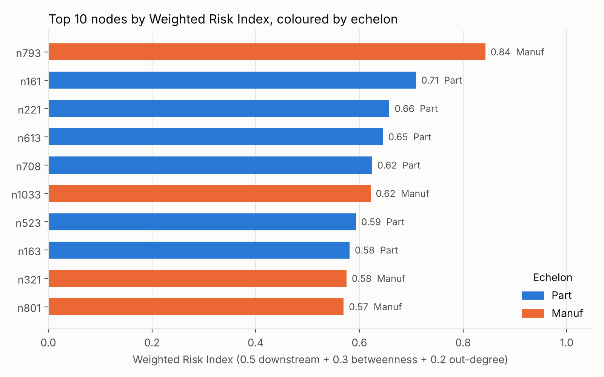
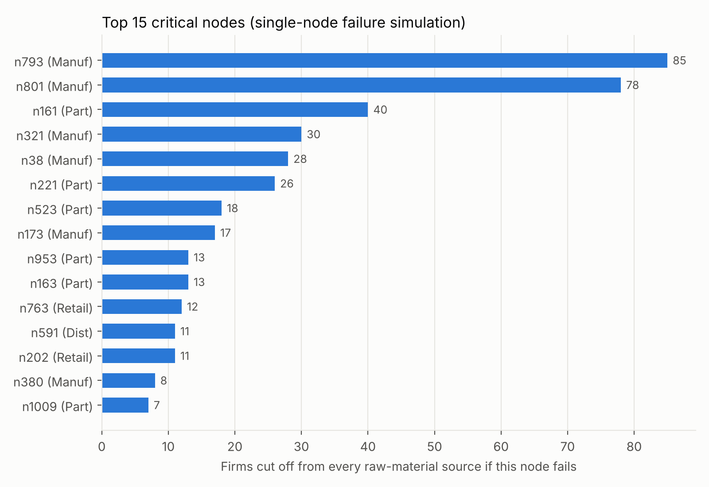
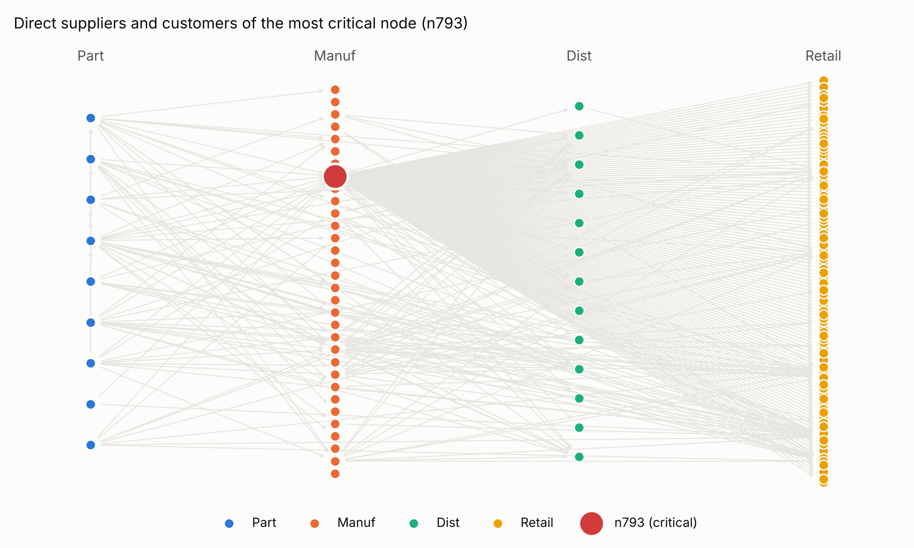

# Exploring the Impact of Disruptions on Supply Chains

Network analysis of a real-world supply network to find **critical** firms (whose failure cuts others off from raw materials) and **vulnerable** firms (most exposed to upstream failures).

**PURE – Program for Undergraduate Research, Sabancı University (Oct 2025 – Jan 2026)**
Görkem Kocamanoğlu · Mustafa Mert Mutlu · Simay Karaca
Supervisor: Assoc. Prof. Fatma Tevhide Altekin



## Problem

Modern supply chains are large, interconnected and exposed to disruptions. We model organisations as nodes and supply relationships as directed edges, then ask two questions:

1. **Criticality:** which firms, if they fail, disconnect the most downstream firms?
2. **Vulnerability:** which firms lose access to raw materials most often when *other* firms fail?

## Data

The network comes from the **IFAC MIM 2025 Data Challenge – Complex Network Analysis track**. The full data set describes 7,200+ organisations and about 44,000 supply relationships. Node identifiers are anonymised; each node has a country and a product description.

**The analysis in this repository runs on the challenge's anonymised sample: 1,035 nodes and 6,529 edges.**

The raw data is not redistributed here because access requires registration with the challenge. See [`data/README.md`](data/README.md) for the expected file format.

## Method

| Step | What happens |
|---|---|
| 1. Load | Nodes and edges are read into a directed graph (`networkx.DiGraph`). |
| 2. Echelon classification | Inspired by Willems (2008), each node is assigned to Part → Manufacturing → Distribution → Retail using product keywords, refined by topology. A node with no supplier is an entry point (Part); a node with no customer is Retail. |
| 3. DAG construction | Edges flowing backwards in this hierarchy are removed, and the remaining cycles are broken with depth-first search. The result is a directed acyclic graph. |
| 4. Weighted Risk Index | `0.5 × downstream impact + 0.3 × betweenness centrality + 0.2 × out-degree`, each min-max normalised to [0, 1]. |
| 5. Supply-starvation simulation | Each node is removed in turn. A node is *starved* if it can no longer reach any Part node. **Criticality** = how many nodes one failure starves. **Vulnerability** = in how many scenarios a node is starved. |

## Results (sample network)

After cleaning, the DAG keeps 4,486 of 6,527 loaded edges: 1,458 backward edges and 583 cycle edges are removed. The echelons hold 135 Part, 220 Manufacturing, 112 Distribution and 568 Retail nodes.



- **Risk is concentrated.** A handful of vehicle-part manufacturers and raw-material suppliers (steel, alumina, copper) dominate both rankings. The single most critical node, a vehicle-parts manufacturer, starves **85 firms (8.2% of the network)** when it fails.
- **The network is redundant against single failures.** 58.6% of firms are never cut off from raw materials by any single failure, and no firm is cut off in more than 2 of the 1,035 scenarios.
- **Criticality and vulnerability are nearly uncorrelated** (r = −0.08). The firms that would hurt the network most are not the ones most exposed to upstream failures.



## Revision note: v2 vs. the original report

While preparing this repository we found and fixed two issues in the original Colab notebook:

1. **Data loading.** 503 of the 1,035 rows in the node file were wrapped in an extra pair of quotes, so `pandas` read each of them as a single field. Those nodes never matched their edges, and **only 1,438 of the 6,529 edges entered the graph**. Most of the edge loss described in the original report came from this, not from cycle-breaking.
2. **Source re-assignment.** Some nodes lost all their suppliers during cleaning but kept a Manufacturing/Distribution label. They were then counted as starved in every scenario, which produced the artificial vulnerability score of 1,034.

With both fixed, the qualitative conclusion holds: risk sits in a small set of manufacturing and raw-material nodes. However, the "fatal node" and "kill chain" findings and the uniform vulnerability score of 1,034 in the original report do not hold on the corrected data.

## Repository structure

```
├── notebooks/
│   ├── supply_chain_disruption_analysis.ipynb   # v2 pipeline, executed on the sample
│   └── archive/original_colab_notebook.ipynb    # original exploratory notebook (outputs cleared)
├── src/
│   ├── pipeline.py      # loading, echelon classification, DAG, risk index, simulation
│   └── figures.py       # charts used in this README
├── figures/             # generated PNGs
├── report/              # PURE final report (PDF)
├── data/README.md       # data source and expected format (raw data not included)
├── requirements.txt
└── LICENSE
```

## Reproduce

```bash
pip install -r requirements.txt
# place nodes.csv and edges.csv in data/ (see data/README.md)
python src/pipeline.py --nodes data/nodes.csv --edges data/edges.csv --out results
# or open notebooks/supply_chain_disruption_analysis.ipynb
```

## Limitations and future work

- The data has no lead times, volumes, capacities or distances, so every edge has unit weight.
- Echelon labels come from keyword heuristics and topology, not from ground truth.
- Only single-node failures are simulated. Multi-node and regional (country-level) shocks are a natural next step.
- The risk-index weights are a modelling choice and can be tuned to reflect managerial preferences.

## References

- Hua, Z., Xia, Y., Chen, Y., & Sun, W. (2025). Identification of critical nodes in supply chain networks. *AIP Advances, 15*(1), 015224. https://doi.org/10.1063/5.0249078
- Willems, S. P. (2008). Data set—Real-world multiechelon supply chains used for inventory optimization. *Manufacturing & Service Operations Management, 10*(1), 19–23. https://doi.org/10.1287/msom.1070.0176
- IFAC MIM 2025 Data Challenge: https://conferences.ifac-control.org/mim2025/

## License

Code: [MIT](LICENSE). The report in `report/` is shared for reference; the challenge data is not included.
